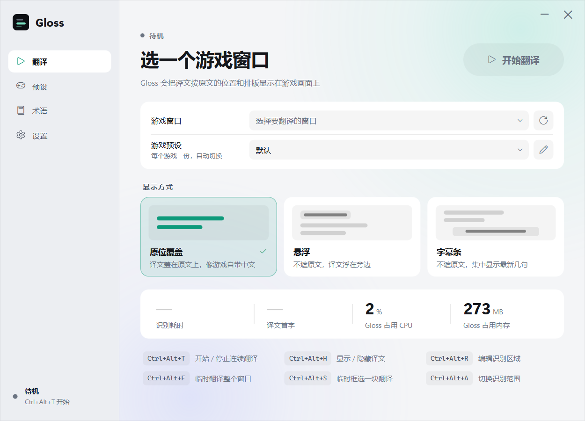

# Gloss

实时游戏文本翻译悬浮层。捕获游戏窗口 → OCR → 翻译，再把译文**按原文的位置、字号、颜色和折行**盖回去。

名字取自 *gloss*：写在原文行间的译注，也是 glossary（术语表）的词根。



## 下载运行

需要 Windows 10 2004 以上（开发和测试在 Windows 11 上）。

到本仓库的 Releases 页下载 `Gloss-<版本>-win64.zip`，解压到任意位置，双击里面的 `Gloss.exe`。不需要安装 Python。

- 设置、游戏预设和翻译缓存存在 `%APPDATA%\Gloss`，删掉程序文件夹不会丢。
- 本地翻译模型不在压缩包里：在「设置」页选「混元 Hy-MT2」后点「下载」（约 1.2 GB），文件放在 `%LOCALAPPDATA%\Gloss\local-mt`。
- 程序没有数字签名，第一次运行时 Windows 可能弹出"已保护你的电脑"，点"更多信息 → 仍要运行"。

## 从源码运行

需要 [uv](https://docs.astral.sh/uv/)。双击 `gloss.cmd`，或者在终端里：

```powershell
$env:UV_PROJECT_ENVIRONMENT = "$env:LOCALAPPDATA\Gloss\venv"; uv run --python 3.12 python -m gloss
```

`gloss.cmd` 把虚拟环境放在 `%LOCALAPPDATA%\Gloss\venv` 而不是项目目录里（约 1 GB 的依赖，放在同步盘里的项目不必跟着同步）；不在意的话直接 `uv run python -m gloss` 也行。第一次启动会下载 OCR 模型（几十 MB）。

## 打包

```powershell
uv run python packaging/build.py
```

用 PyInstaller 打出 `dist/Gloss/`（解压即用的文件夹）和 `dist/Gloss-<版本>-win64.zip`。打包完会自动用 `Gloss.exe --selftest` 跑一遍自检：加载各个原生库、用 OCR 认一张图、创建翻译后端、加载全部界面文件，任何一步不过就算打包失败。

## 使用

1. 游戏用**窗口化或无边框**模式运行（独占全屏下悬浮层显示不出来）。
2. 在「翻译」页选中游戏窗口，点「开始翻译」。
3. 翻译后端在「引擎」页选。推荐本地翻译模型「混元 Hy-MT2」：在那一页点「下载」（约 1.2 GB）即可，装好后离线运行。没装时默认用免密钥的 Google 机翻。

| 默认快捷键 | 作用 |
|---|---|
| `Ctrl+Alt+T` | 开始 / 停止连续翻译 |
| `Ctrl+Alt+H` | 显示 / 隐藏译文 |
| `Ctrl+Alt+R` | 打开 / 收起识别区域编辑器 |
| `Ctrl+Alt+F` | 临时翻译整个窗口（再按一次清除） |
| `Ctrl+Alt+S` | 临时框选一块翻译 |
| `Ctrl+Alt+A` | 切换识别范围：整个窗口 / 固定区域 |

快捷键都可以改：在「设置」页的"快捷键"里点一下按键，再按新的组合。组合里要带 Ctrl、Alt 或 Win，功能键可以单独用；Backspace 清除，被别的程序占用的会标出来。在游戏里按快捷键时，如果前台窗口不是当前选中的那个，Gloss 会改成翻译前台窗口，所以不用先回到控制面板选窗口。每次按键后，游戏画面顶部会出现一行提示说明发生了什么。

## 功能

**主题。** 控制面板有五个主题：浅色（默认）、暖纸、深色、墨蓝，以及跟随 Windows 的浅色 / 深色设置。在「设置」页顶上选，立刻生效。游戏画面上的译文样式不受主题影响，它在「预设」页里单独设置。

**三种显示方式。**

- **原位覆盖**：译文按原文的位置、字号、颜色盖在原文上。折行的段落合成一块整体翻译，译文在原段落的框里重新折行，行距锁定为原文行距；菜单项、按钮这类短标签逐个原位替换。
- **悬浮**：不遮原文。译文以半透明的小标签浮在原文旁边，自动挑原文的上、下、右、左中不挡别的文字的一侧。
- **字幕条**：不遮原文，把最新的几句集中显示在原文上方。

**临时翻译。** 不想一直开着连续翻译时用：

- 临时翻译整个窗口：把当前画面识别、翻译一次，译文停留一段时间后自动消失（默认 10 秒，在「设置」页可调，0 表示一直留到再按一次）。
- 临时框选一块：在游戏画面上拖一个框，松手就只翻这一块，不存进预设。

第一次临时翻译要加载模型，会等几秒（提示里会写"正在加载模型"）；之后模型留在内存里待命，再按就是即时的，从待命转成连续翻译也不用重新加载。待命 3 分钟没再用，模型会自动卸掉。连续翻译开着时也能用临时翻译，比如连续翻译只盯着对话框，临时看一眼整屏的菜单。

**识别范围切换。** 每个游戏的预设里可以同时留着固定区域和"整个窗口"两种范围，用快捷键或「预设」页的开关来回切，区域不会被删。正在运行的翻译立刻按新范围识别，不用重新开始。

**每个游戏一份预设。** 在「翻译」页选中一个游戏窗口，Gloss 就切到这个游戏自己的预设；它还没有预设时，按「默认」预设的设置新建一份，绑定到它的程序名。之后对识别区域、显示方式、语言、术语表、游戏说明的改动都只属于这个游戏。只选中过、没改过也没开始翻译的窗口不会留下预设。

**在游戏里编辑识别区域。** 按 `Ctrl+Alt+R`（或在「预设」页点「在游戏里编辑区域」），游戏画面上会出现一层编辑器：拖空白处新增区域，拖方框移动，拉边和角调整大小，点方框右上角的 × 删除，可以框任意多个。每次松手都立刻存进当前游戏的预设；正在运行的翻译马上按新区域识别，不用重新开始。

**外观。** 在「预设」页的"显示"里调，带实时预览，改动立刻作用到游戏上的译文：文字颜色、底色、底色不透明度、字体（系统里装的都能选）、字号、字重、文字描边。原位覆盖模式下文字颜色和底色默认跟随原画面，也可以改成自选。这些设置同样是每个游戏一份。

**术语表。** 跟着游戏预设走。混元模型和大模型后端只把本次原文里出现的术语放进提示词；传统机翻在翻译前直接替换。

**翻译引擎。** 在「引擎」页选，共 24 个。"验证"一栏说明我把它验证到了什么程度：

| 类别 | 引擎 | 验证 |
|---|---|---|
| 本地 | 混元 Hy-MT2（推荐）、NLLB-200 | 在本机用真实模型跑通并测速 |
| 本地 | Ollama、LM Studio、llama.cpp / Sakura | 协议对真实的 llama.cpp 服务验证过；Ollama 和 LM Studio 没装，没测 |
| 在线机翻 | Google（免密钥） | 真实服务跑通；非官方接口，会被限流 |
| 在线机翻 | DeepL、DeepLX / DLX、有道智云、彩云小译 | 按官方文档实现，只用模拟服务器测过，没有密钥 |
| 在线机翻 | 微软 Azure、百度翻译、腾讯云 | 官方文档没查全（腾讯云的签名算法查到了，并对上了文档示例里的中间结果），只用模拟服务器测过 |
| 大模型 | DeepSeek、OpenAI、Gemini、通义千问、智谱 GLM、Kimi、豆包、硅基流动、OpenRouter、自定义 OpenAI 兼容接口 | 共用一套 OpenAI 兼容实现，协议对真实的 llama.cpp 服务验证过；各厂商没有密钥，没测 |
| 大模型 | Claude API | 官方 SDK，只用模拟服务器测过 |

没连真实服务验证过的引擎，选中时界面上会有一行黄色提示。各引擎要填的密钥、模型名、地址由 `gloss/translate/registry.py` 里的登记表生成，加引擎只需在那里加一项并写一个实现类。

### 翻译后端实测

开发机（RTX 5060 Laptop 8 GB、20 线程 CPU）上用 `tests/bench_translate.py` 测的中位数，括号里是最差值。
"一句对话"是一句 20 字左右的日文，"一屏 8 条"模拟刚进游戏整屏都要翻的情况。

| 后端 | 启动 | 一句对话 | 带术语 | 一屏 8 条 | 内存 | 显存 | 翻译时 CPU |
|---|---|---|---|---|---|---|---|
| 混元 · 独立显卡 | 1.8 s | 85 ms（112），首字 33 ms | 108 ms | 320 ms | 0.24 GB | 1.4 GB | 0.7 核 |
| 混元 · CPU 6 线程 | 5.1 s | 377 ms（479） | 548 ms | 876 ms | 1.2 GB | 0 | 6 核 |
| 混元 · 核显 | 12.8 s | 609 ms（858） | 830 ms | 2.5 s | — | 0 | 0.5 核 |
| NLLB · CPU 4 线程 | 0.8 s | 223 ms（286） | 222 ms | 342 ms | 0.7 GB | 0 | 4 核 |
| Google 机翻 | — | 72 ms（637） | — | 134 ms（1530） | — | — | — |

上面是**显卡空闲时**的数字。实际玩游戏时显卡是被游戏占着的，结果完全不同。下面是开着一个把显卡占到 98%、显存用掉 5.7 GB 的游戏时测的：

| 后端 | 一句对话 | 一屏 8 条 |
|---|---|---|
| 混元 · 独立显卡 | 1075 ms（1449） | 2031 ms |
| 混元 · CPU 6 线程 | 406 ms（543） | 1087 ms |
| 混元 · CPU 4 线程 | 555 ms（726） | 1363 ms |
| NLLB · CPU 4 线程 | 299 ms（355） | 436 ms |
| Google 机翻 | 63 ms（75） | 135 ms |

- **混元和游戏抢显卡时慢了十几倍，反而不如跑在 CPU 上。** 所以运行设备的"自动"是这样定的：开始翻译时看一眼显卡，占用率高或剩余显存不够就用 CPU（6 线程），否则用显卡。同样负载下自动模式实测单句 436 ms。它只在开始翻译时判断一次，中途游戏负载变了不会切换。
- 游戏吃满显卡时，延迟最低的是在线的 Google 机翻；本地方案里最快的是 NLLB，但质量差（把 "Quit to Desktop" 译成"停止使用桌面"，人名每句译得都不一样）；混元 CPU 模式约 0.4 秒，质量好，术语表实测生效。
- 显卡空闲（比如回合制、视觉小说这类不怎么吃显卡的游戏）时，混元跑在显卡上最快也最稳，代价是约 1.4 GB 显存。
- 混元在显卡上运行时，模型文件另有约 1.2 GB 以文件映射的形式出现在进程内存里，系统内存紧张时可以回收，表里没有计入。
- Google 的中位数很快，但空闲时那轮测试里有 0.6–1.5 秒的尖峰，几分钟内发了一百多个请求后还被限流过（返回 429 和 500）。
- 其它在线引擎和大模型没有密钥，没测。有密钥时可以用同一个脚本测 Claude 和 OpenAI 兼容接口，用法见脚本开头。

**OCR 引擎。**

| 引擎 | 说明 |
|---|---|
| RapidOCR（默认） | PP-OCRv6，中日英一个模型。三档：快（仅中英）/ 均衡 / 精确 |
| Windows 自带 OCR | 最快（英文全屏约 30 ms），但只能识别系统已装语言包的语言 |
| OneOCR | 截图工具的引擎，实验性，需自行准备模型文件，见 `gloss/ocr/oneocr.py` |

## 占用

「翻译」页上有两个实时指标：Gloss 自己（含本地翻译模型的进程）占了整机多少 CPU、多少内存，每 2 秒更新一次。

第一版开着之后游戏会卡。用 `tests/bench_pipeline.py` 对着一个 2560×1440、画面不停在动的测试窗口量出来，Gloss 自己平均吃掉了 5 个多 CPU 核。逐个环节拆开量之后，问题和对应的改动是：

| 问题 | 改动 |
|---|---|
| OCR 引擎的线程在两次识别之间原地空转。一次 0.27 秒的识别、每 0.9 秒一次，本该占不到 1 个核，实际占了 5.4 个 | 关掉空转。同样的识别降到 0.8 个核，耗时不变 |
| 判断画面变没变时，每次都把整张大图转灰度再缩小，还拉起了 20 个线程 | 改成隔几个像素取一个点。每次 3.5 ms 降到 0.7 ms，占用从半个核降到几乎为零 |
| 窗口捕获每秒拷贝 25 帧全分辨率画面 | 降到每秒 10 帧，换了更快的拷贝方式 |
| 画面一直在动时，每 0.7 秒把整屏文字重新识别一遍 | 只重新识别像素变了的文字行，没变的直接用上次的结果；文字一直没变就把间隔逐步拉长到最多 2 秒 |
| 画面静止时仍然每 60 毫秒检查一次 | 静止 2 秒后放慢到每 0.2 秒一次，一有动静马上恢复 |
| Gloss 和游戏抢 CPU | Gloss 和本地翻译模型的进程都降到"低于普通"优先级 |

同一个测试窗口上的结果（只算截屏、变化检测、OCR 和分块，不含翻译）：

| 场景 | 改之前 | 改之后 |
|---|---|---|
| 画面一直在动，识别整个窗口 | 5.28 核 | 0.46 核 |
| 画面一直在动，只识别框选的对话框区域 | 5.36 核 | 0.07 核 |
| 画面静止，识别整个窗口 | 1.03 核 | 0.07 核 |

这是在测试窗口上量的，不是在真实游戏里量的；真实游戏里的数字以「翻译」页上的实时指标为准。最有效的省法是框选区域：只识别有文字的地方，占用低一个数量级，反应也最快。

## 它为什么快

- 画面没变就什么都不做；文字还在变（打字机效果）就等它停下来。
- 画面只变了一小块时只识别那一块：对话框换一句话，不用重新识别整个屏幕。
- 同一段文字沿用已有译文，译过的句子进缓存（按预设存盘）。
- 一轮 OCR 里的新文本合并成一个翻译请求，流式返回、逐字显示。

在开发机上（1600×900 的测试窗口，RapidOCR 均衡档，CPU）：首帧全屏识别约 400 ms，之后对话换句约 35–120 ms；Google 机翻约 0.1–0.8 秒返回。只框选对话框时，首次识别约 90 ms。这些是端到端测试里几次运行的读数，不是系统的基准测试。

## 项目结构

```
gloss/
  app.py          界面与管线之间的胶水（Backend、悬浮层数据模型、热键）
  pipeline.py     实时管线：变化检测、局部 OCR、块的匹配与翻译调度
  capture.py      窗口捕获（Windows Graphics Capture）与屏幕区域捕获
  layout.py       把 OCR 的行整理成块，估计字号、对齐、颜色
  hotkeys.py      全局快捷键：动作、默认按键、按键写法的换算
  selftest.py     自检：确认各部件都能加载（打包后用它验证没漏文件）
  placement.py    悬浮模式下译文标签放在原文的哪一侧
  ocr/            RapidOCR / Windows OCR / OneOCR
  translate/      翻译引擎：registry.py 是登记表，cloud.py 是各家在线机翻，另有混元、NLLB、Google、Claude、OpenAI 兼容
  local_mt.py     本地翻译模型文件的位置、下载与校验
  config.py       设置与预设的读写
  presets/        内置预设模板
  ui/             QML：Main（控制面板）、Overlay（悬浮层）、RegionPicker（框选）
packaging/
  build.py        打包脚本（PyInstaller）
  launcher.py     打包后程序的入口
tests/
  test_*.py       单元测试（排版、解析、管线逻辑、后端请求）
  fake_game.py    假游戏窗口
  e2e.py          端到端：真实管线翻译假游戏，把合成画面存成 PNG
  shots.py        把控制面板各页渲染成 PNG
  bench_translate.py  各翻译后端的延迟和资源占用实测
  bench_pipeline.py   管线自己（截屏、变化检测、OCR）的 CPU 占用实测
```

## 测试

```powershell
$env:UV_PROJECT_ENVIRONMENT = "$env:LOCALAPPDATA\Gloss\venv"; uv run pytest
```

```powershell
$env:UV_PROJECT_ENVIRONMENT = "$env:LOCALAPPDATA\Gloss\venv"; uv run python tests/e2e.py _debug/e2e
```

端到端测试会联网调用 Google 机翻。测试窗口压在所有窗口下面，不会打扰正在用电脑的人。

## 已知限制

- 目前只在假游戏窗口上验证过，还没有在真实游戏里长时间跑过。
- 24 个翻译引擎里，连真实服务跑通的只有混元、NLLB、Google 和（通过 llama.cpp）OpenAI 兼容协议；其余都只用模拟服务器测过，见上面的表。
- 识别整个窗口、画面又一直在动时（3D 游戏的实机画面），新出现的文字最长要等约 2 秒才会被发现；框选区域后没有这个问题。
- 混元的运行设备只在开始翻译时自动判断一次；悬浮模式的标签位置是按估算的标签大小选的，文字很密的画面里仍可能互相遮挡。
- 本地翻译模型放在 `%LOCALAPPDATA%\Gloss\local-mt`，卸载时手动删除该目录。
- 混元模型每条请求的上下文是 1024 个 token，特别长的整段文字（几百字以上）会翻译失败。
- OneOCR 引擎的代码没有运行过。
- 独占全屏的游戏不支持；HDR 画面的取色可能不准。
- 艺术字体、竖排文字、纹理背景上的文字识别率会下降；背景是渐变或图片时，纯色底框会看得出来。
- 主窗口是无边框的，不能拖边缩放。
- 打包版没有数字签名，也只在开发机上跑过自检，没有在别的电脑上装过。
- API 密钥明文存在 `%APPDATA%\Gloss\settings.json`；不想存盘可以留空，改用环境变量 `ANTHROPIC_API_KEY`。

## 第三方组件

Gloss 用到的开源组件、可选下载的模型和它们的许可证见 [THIRD_PARTY_NOTICES.md](THIRD_PARTY_NOTICES.md)。
